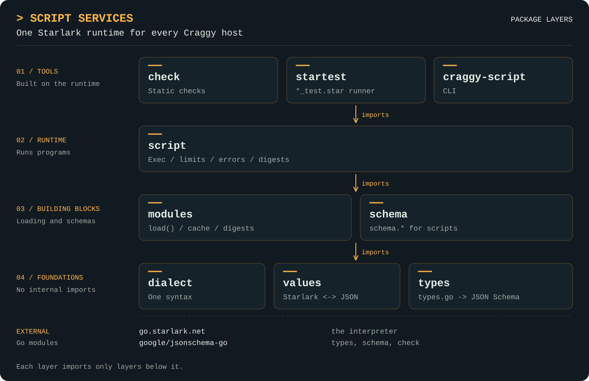

<picture>
  <source media="(prefers-color-scheme: dark)" srcset="docs/assets/craggy-wordmark-on-dark.svg">
  
</picture>

# Script Services

A generic Starlark runtime for Go hosts. One dialect, one value model and one
module loader serve every Craggy library that runs scripts: hosts run programs
under step and wall-clock limits, check them statically against the callables
they will provide, declare inputs and outputs as JSON Schema, and test them with
`*_test.star` files. Authored scripts reach it through
[foundation-kit bundles](https://github.com/craggy-io/foundation-kit): every
folder of scripts is a bundle with a real `bundle.yaml`, loaded by `bundle.Load`
and compiled by one shared compiler, [`starcompile`](docs/starcompile.md).

The module is `github.com/craggy-io/script-services`. It knows nothing about
registries or capabilities: a host describes its own built-ins as Starlark values
(for execution) and `check.Callable` entries (for static checking). The capability
registry and the computational-research platform both build on it; neither is
imported here.

## Features

- **One dialect everywhere:** [Exec, Check, load() and the test runner all parse through one dialect](docs/dialect.md) (Starlark plus `set()`, `while`, top-level control flow and global reassignment; no recursion).
- **Bounded, classified execution:** [run a program and its entry function](docs/script.md) under step and time limits, with JSON input and output, `*script.Error` codes, positions, backtraces and host errors reachable through `errors.As`.
- **Content-addressed modules:** [resolve `load()` specs](docs/modules.md) (`./`, `../`, `//`, bare, and `@alias/` for a dependency bundle), serve them from a bundle contribution, execute each module once, coalesce concurrent loads, detect cycles, and digest source plus each `load()` spec paired with its module's digest rather than paths, statically or by running.
- **One compiler for bundle scripts:** [`starcompile`](docs/starcompile.md) turns a `.star` contribution into a checked Unit with file:line diagnostics; domains plug in their built-ins and build their own values, and the generic `craggy.script@1` kind needs no domain at all.
- **Types from Go syntax:** [turn `types.go` declarations into JSON Schema](docs/types.md) with the shapes and required rules `jsonschema.For` derives (with a few documented deviations), and [let scripts declare schemas](docs/schema.md) with a `schema` module.
- **Static checking:** [validate dotted callable paths, literal refs, keyword arguments and load() targets](docs/check.md) against a host-supplied Env, with nearest-name suggestions.
- **Starlark tests and a CLI:** [run the `*_test.star` files a bundle declares](docs/startest.md) (`craggy.script-test@1`) with an `assert` module from Go tests or the [`craggy-script` command](docs/cli.md), which also checks and runs a bundle's scripts and prints its type schemas (`craggy.types@1`).
- **One value model:** [convert Starlark, Go and JSON values](docs/values.md) with a single fixed set of rules.

## Package architecture

<p align="center">
  <a href="docs/assets/script-services-architecture.svg">
    
  </a>
</p>

Read it top to bottom: each layer imports only the layers below it. The full direct
import list per package:

| Package | Responsibilities | Imports (in this module) | Guide |
| --- | --- | --- | --- |
| `dialect` | The one Starlark dialect: Parse, Resolve, Compile. | none | [Dialect](docs/dialect.md) |
| `values` | Starlark ↔ Go ↔ JSON conversion; built-in kwargs to JSON. | none | [Values](docs/values.md) |
| `types` | Go-syntax type declarations to JSON Schema; the `craggy.types@1` kind. | none | [Types](docs/types.md) |
| `schema` | The Starlark `schema` module; schema values to `*jsonschema.Schema`. | types, values | [Schema](docs/schema.md) |
| `modules` | `load()` resolution, sources (including bundle contributions), execution, caching, cycles, native modules and digests. | dialect | [Modules](docs/modules.md) |
| `script` | Exec, limits, classified errors, Run/Call helpers. | dialect, modules, values | [Script](docs/script.md) |
| `check` | Static checking against an Env of callables. | dialect, modules, script | [Check](docs/check.md) |
| `starcompile` | The shared compiler from a `.star` contribution to a checked Unit; the `craggy.script@1` kind. | check, dialect, modules, script | [Starcompile](docs/starcompile.md) |
| `startest` | `*_test.star` runner, `assert` module and the `craggy.script-test@1` kind. | check, dialect, modules, script, starcompile | [Startest](docs/startest.md) |
| `cmd/craggy-script` | `check`, `run`, `test` and `types` commands over a bundle. | script, starcompile, startest, types | [CLI](docs/cli.md) |

External dependencies are `go.starlark.net`, `github.com/google/jsonschema-go`
and `github.com/craggy-io/foundation-kit` (`bundle` and `kind`, imported by
`modules`, `types`, `starcompile`, `startest` and the CLI). `startest` imports the
standard `testing` package. The architecture diagram predates `starcompile`,
which sits between `check` and `startest`.

## Quick start

Run a program whose `load()` statements are served from memory. `Exec` runs the
module body, then `run(input)`; the result is JSON, with the modules used and a
digest over the source and its direct `load()`s, each spec paired with the
loaded module's digest (the same digest the file would have as a module). This is
[`ExampleExec`](script/example_test.go), compiled and checked by `go test`:

```go
loader := modules.NewLoader(modules.Map(map[string]string{
	"lib/text.star": "load('./util.star', 'twice')\ndef shout(s):\n    return twice(s.upper())\n",
	"lib/util.star": "def twice(s):\n    return s + s\n",
}), modules.Options{MaxSteps: script.DefaultLimits.MaxSteps})

src := []byte(`
load("./lib/text.star", "shout")

print("starting")

def run(input):
    return {"greeting": shout(input["who"])}
`)
res, err := script.Exec(ctx, script.Program{
	Filename: "main.star",
	Source:   src,
	Input:    map[string]any{"who": "ab"},
	Modules:  loader,
}, script.Options{
	Limits: script.DefaultLimits,
	Print: func(pos script.Position, msg string) {
		fmt.Printf("%s:%d: %s\n", pos.File, pos.Line, msg)
	},
})
// main.star:4: starting
// res.Value   == {"greeting":"ABAB"}
// res.Modules == [lib/text.star lib/util.star] (with digests)
// res.Digest  == modules.Digest(src, []modules.Dep{{Spec: "./lib/text.star", Digest: <lib/text.star's digest>}})
```

Failures are `*script.Error` values (`Invalid` or `Cancelled`) with a position in
the script, a backtrace, and `Unwrap` to the original cause; see
[script errors](docs/script.md#semantics-errors-and-limits).

### Load scripts from bundles

Authored scripts live in bundles: a folder with a `bundle.yaml` that names each
contribution's kind and path. **A folder without a `bundle.yaml` is not loaded,
and nothing generates one.** A domain declares its kind and builds its compiler
from `starcompile.Compiler`, passing its own built-ins; `bundle.Load` does the
rest. From [`ExampleCompiler`](starcompile/example_test.go):

```yaml
# bundle.yaml
apiVersion: craggy.io/bundle/v1
metadata: {id: example.app, version: 1.0.0}
dependencies:
  - id: example.names          # load('@example.names/names.star', ...)
contributions:
  - {id: reviewers, kind: example.team@1, path: teams/reviewers.star}
```

```go
var TeamKind = kind.New[Team]("example.team", 1)

opts := starcompile.Options{Check: check.Env{Predeclared: []string{"team"}}}
compiler := bundle.Compile(TeamKind, starcompile.Compiler(opts,
	func(ctx context.Context, u *starcompile.Unit) (bundle.Compiled[Team], []bundle.Diagnostic) {
		var t Team
		team := starlark.NewBuiltin("team", collectInto(&t)) // a fresh collector per file
		if _, err := u.Exec(ctx, starcompile.ExecOptions{Predeclared: starlark.StringDict{"team": team}}); err != nil {
			return bundle.Compiled[Team]{}, u.Diagnostics(err) // file:line diagnostics
		}
		return bundle.Compiled[Team]{Value: t}, nil
	}))
cat, err := bundle.Load(ctx, bundle.Options{Sources: sources, Compilers: []bundle.AnyCompiler{compiler}})
```

### Check before running

Describe what the host will predeclare and check the script without executing it.
From [`ExampleAnalyze`](check/example_test.go):

```go
get := check.Callable{Name: "storage.artifact.get", Input: getIn, Value: "host payload"}
env := check.Env{
	Callables:   []check.Callable{get},
	Predeclared: []string{"log"},
	RefFuncs:    map[string]func(string) (check.Callable, bool){"call": resolveRef},
	Modules:     modules.Map(map[string]string{"lib/util.star": "def twice(s):\n    return s + s\n"}),
	Noun:        "capability", // messages say "callable" by default
}
a := check.Analyze(env, "main.star", src)
// 3:5 error: unknown capability storage.artifact.gte (did you mean storage.artifact.get?)
// 4:5 error: storage.artifact.get has no input "idd" (did you mean id?)
// a.Uses  == [storage.artifact.get]   a.Loads == [lib/util.star]
```

### Types to schema

Declare inputs and outputs in Go syntax and derive JSON Schema without compiling
the file. From [`ExamplePackage_Schema`](types/example_test.go):

```go
// types.go — parsed, never compiled
package api

// DecompileIn is what apk.decompile takes.
type DecompileIn struct {
	Artifact string `json:"artifact" jsonschema:"artifact id"`
	Depth    *int   `json:"depth,omitempty"` // how deep to go
	Level    Level  `json:"level"`
}

// Level is a decompiler effort level.
// enum: fast, full
type Level string
```

```go
pkg, err := types.Parse("types.go", src)
s, err := pkg.Schema("DecompileIn")
// closed object (additionalProperties false); required [artifact level]
// (depth is omitempty; a pointer without omitempty would be required);
// depth is {"type":["null","integer"]}; level carries "enum":["fast","full"]
```

Pass `schema.WithTypes(pkg)` to `schema.Module` and `schema.Of` so scripts can
write `schema.type("DecompileIn")`; see [schema](docs/schema.md).

### The CLI

Every command takes a bundle directory, optionally with `#ID` to pick one
contribution. Single files and loose folders are not accepted.

```sh
go run ./cmd/craggy-script run -input '{"who":"ab"}' ./myscripts#main
go run ./cmd/craggy-script check ./myscripts
go run ./cmd/craggy-script test -dep ./shared-lib ./myscripts
go run ./cmd/craggy-script types ./myscripts#api DecompileIn
```

See the [CLI guide](docs/cli.md) for the kinds it reads, output formats and exit
codes.

Start with the [documentation index](docs/README.md). For coding-agent integration
and repository development guidance, see [AGENTS.md](AGENTS.md).

## Development

Requires Go 1.27 or newer. Dependencies: `go.starlark.net`,
`github.com/google/jsonschema-go` and `github.com/craggy-io/foundation-kit`.

```sh
go test ./...
go test -race ./...
go vet ./...
go build ./...
```

Package examples (`example_test.go`) carry `// Output:` checks, so `go test`
verifies the code shown in the guides.
